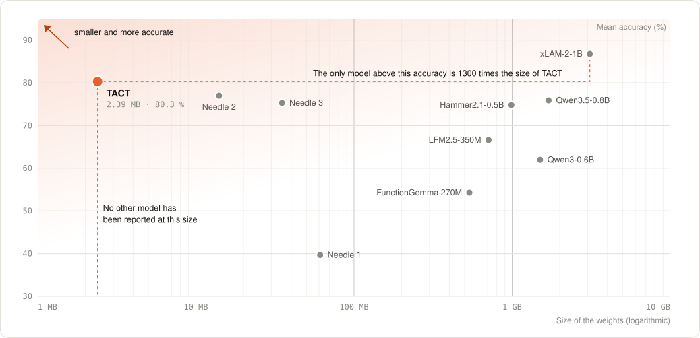

# TACT: a 2.39 MB function-calling language model, more accurate than open models up to 700 times its size

TACT (Ternary Action-Calling Transformer) reads a request in plain language together with the list of functions a device offers and returns the function calls that carry the request out. It has 7.4 million parameters and its weights occupy 2.39 MB. On device-control tests it is more accurate than open models up to 700 times its size.

**[Demo in the browser](https://glimmer-x.github.io/TACT-tiny-function-calling-model/)** · [Paper](https://doi.org/10.5281/zenodo.24529121) · [Weights on Hugging Face](https://huggingface.co/Glimmer-X/TACT-tiny-function-calling-model)



```
request     lock the garage and switch off the bedroom light
functions   set_light(room, state, brightness)   set_thermostat(temperature)   lock_door(door, locked)

output      [{"name": "lock_door", "arguments": {"door": "garage", "locked": true}},
             {"name": "set_light", "arguments": {"room": "bedroom", "state": "off"}}]
```

The function list is given at run time, so a new device only needs its own list.

## Use

```bash
pip install git+https://github.com/Glimmer-X/TACT-tiny-function-calling-model
```

```python
import tact

functions = [
    {"name": "set_light",
     "description": "Turn a light on or off and set its brightness.",
     "parameters": {"type": "object",
                    "properties": {"room": {"type": "string"},
                                   "state": {"type": "string", "enum": ["on", "off"]},
                                   "brightness": {"type": "integer"}},
                    "required": ["room", "state"]}},
]

model = tact.load()                 # downloads the weights on first use
device = model.bind(functions)      # encodes the function list once
device("turn on the kitchen light at 40 percent")
# [{'name': 'set_light', 'arguments': {'room': 'kitchen', 'state': 'on', 'brightness': 40}}]
```

Functions are described in the JSON Schema form used by most function-calling interfaces. `device(request)` returns a list of calls, or `None` when the output is not a list of calls. `device.batch(requests)` answers several requests at once. The model runs on a CPU; pass `device="cuda"` to `tact.load` for a GPU.

[examples/quickstart.py](examples/quickstart.py) is a complete script.

## Model

| | |
|---|---|
| Parameters | 7.4 million |
| Weights | 2.39 MB |
| Structure | encoder-decoder Transformer, width 512, 8 heads |
| Depth | one encoder block applied 6 times, one decoder block applied 4 times |
| Linear weights | ternary, 2 bits each |
| Embedding | 4096 tokens, 4 bits per value, shared with the output layer |
| Activations | 8 bits at the input of every linear layer |
| Language | English |

Three choices give the size. All weights of the linear layers are ternary. Each stack has one block whose weights are reused at every iteration. The function list is encoded separately from the request, so the list of a device is encoded once and its encoding is reused for every request.

The whole model is in [tact/model.py](tact/model.py).

## Results

Accuracy in percent on four device-control test sets. A request counts as correct when the output calls equal the reference calls in names and in every argument value.

| | Held-out | Authored | External-A | External-B | Mean |
|---|---|---|---|---|---|
| TACT, mean of three training runs | 76.5 | 82.8 | 83.1 | 78.9 | 80.3 |
| The released weights | 75.1 | 83.3 | 85.4 | 78.9 | 80.7 |

The numbers of the other nine models are on the [project page](https://glimmer-x.github.io/TACT-tiny-function-calling-model/#results) and in the paper. The four test sets are in [eval_sets/](eval_sets/), one device per line with its function list, requests and reference calls. `python scripts/evaluate.py` runs the released weights on them and takes about three minutes on a laptop CPU.

## Scope

TACT is built for device control with requests in English. It returns function calls and does not hold a conversation.

## Paper

TACT: A Weight-Shared Ternary Transformer Language Model for Function Calling in a Few Megabytes. Dongkun Xu, Runlong Wang, Xianpo Ni, Tughrul Arslan. Preprint: [doi.org/10.5281/zenodo.24529121](https://doi.org/10.5281/zenodo.24529121)

```bibtex
@misc{xu2026tact,
  title     = {TACT: A Weight-Shared Ternary Transformer Language Model for Function Calling in a Few Megabytes},
  author    = {Xu, Dongkun and Wang, Runlong and Ni, Xianpo and Arslan, Tughrul},
  year      = {2026},
  publisher = {Zenodo},
  doi       = {10.5281/zenodo.24529121}
}
```

## License

MIT, for the code and the weights.
